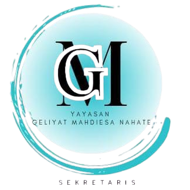

<p align="center">
  
</p>

<h1 align="center">Yayasan Geliyat — Orphan Care & Donation Management Platform</h1>

<p align="center">
  <strong>Together Nurturing Hope, One Step Every Day (Gerakan Peduli Yatim)</strong>
</p>

<p align="center">
   
   
  
   
   
</p>

---

## 📖 About The Project

**Yayasan Geliyat (Gerakan Peduli Yatim)** is an integrated web platform developed as part of the **Warjett X Yayasan Geliyat** IT Consultation Project. This platform serves as an official digital presence (Company Profile) and an internal management system designed for foundation administrators across 5 fostered sub-districts (*kelurahan binaan*).

Designed with a **mobile-first, human-centric approach**, the platform empowers non-technical foundation staff to manage fostered orphan records securely (in compliance with Personal Data Protection regulations), verify manual bank transfer donations via WhatsApp integration, publish foundation activities, and maintain transparent financial bookkeeping.

---

## ✨ Key Features

### 🌐 Public Portal (Company Profile & Donor Interface)
- **Interactive Homepage**: Foundation impact metrics, 4 core program pillars, and latest activity highlights.
- **Foundation Profile (`Profil`)**: History, Vision & Mission, and organizational structure (*Dewan Pembina & Pengurus Harian*).
- **Core Pillars (`Bidang`)**: Deep dive into Education (*Pendidikan*), Humanitarian (*Kemanusiaan*), Cooperative Economy (*Ekonomi Koperasi*), and Religious Programs (*Keagamaan*).
- **Activity Catalog (`Kegiatan`)**: Live search and category filtering for foundation events and social documentation.
- **Fostered Children Directory (`Anak Yatim`)**: Privacy-first public directory displaying anonymized/protected profiles filtered by education level (SD, SMP, SMA, University).
- **Guided Donation Flow (`Donasi`)**: 5-step transparent donation guide, copyable BSI & BRI bank account cards, preset donation nominals, and an automated WhatsApp confirmation generator.

### 🔒 Internal Admin Panel (Role-Based Access Control)
- **Multi-Role Authentication**: Powered by Laravel Fortify with custom middleware (`EnsureUserHasRole`) separating operational staff and executive leadership:
  - **Super Admin (Chairman / *Ketua Yayasan*)**: Full access to executive cash flow dashboards (Income vs. Expense dual charts), Financial Bookkeeping (`Keuangan`), User & Staff Management (`Manajemen Pengguna`), and all operational modules.
  - **Admin (Field Coordinator / *Pengurus Bidang*)**: Focused operational dashboard, Fostered Children CRUD (`Pengelolaan Anak Yatim`), WhatsApp Donation Verification (`Pengelolaan Donasi`), Event Publishing (`Pengelolaan Kegiatan`), and Operational Reports (`Laporan`).

---

## 🛠️ Tech Stack

- **Backend**: Laravel 13 (PHP 8.5), Laravel Fortify (Authentication), Laravel Wayfinder (Typed Routes)
- **Frontend**: React 19, TypeScript, Inertia.js v3
- **Styling & UI**: Tailwind CSS v4, Radix UI Primitives, Lucide Icons, Poppins & Inter Typography
- **Database**: MySQL / SQLite
- **Testing & Quality**: Pest PHP, Laravel Pint

---

## 🚀 Getting Started (Installation)

Follow these steps to set up the project locally on your machine:

### 1. Prerequisites
Ensure you have the following installed:
- **PHP** >= 8.2 & **Composer**
- **Node.js** >= 18.x & **npm**
- **MySQL** (via XAMPP, Laragon, or native service)
- **Git**

### 2. Clone the Repository
```bash
git clone https://github.com/Ghazyxs/yayasan-geliyat.git
cd yayasan-geliyat
```

### 3. Install Dependencies
```bash
composer install
npm install
```

### 4. Configure Environment
```bash
cp .env.example .env
php artisan key:generate
```
Update your `.env` file with your local MySQL credentials:
```env
DB_CONNECTION=mysql
DB_HOST=127.0.0.1
DB_PORT=3306
DB_DATABASE=geliyat
DB_USERNAME=root
DB_PASSWORD=
```
*(Make sure you have created an empty database named `geliyat` in phpMyAdmin or your MySQL client).*

### 5. Run Migrations & Seeders
```bash
php artisan migrate --seed
```

### 6. Run the Development Server
Open two terminal sessions:
```bash
# Terminal 1: Start Laravel backend
php artisan serve

# Terminal 2: Start Vite frontend bundler
npm run dev
```
Visit **[http://localhost:8000](http://localhost:8000)** in your browser.

---

## 🔑 Default Demo Credentials

After running `php artisan db:seed`, you can log in at [`http://localhost:8000/login`](http://localhost:8000/login) using the following accounts:

| Role | Email | Password | Access Scope |
| :--- | :--- | :--- | :--- |
| **Super Admin (Chairman)** | `ketua@geliyat.or.id` | `password` | All Modules + Finance & User Management |
| **Admin (Humanitarian & Orphans)** | `admin@geliyat.or.id` | `password` | Operational Dashboard, Orphans, Donations, Events, Reports |

---

## 🤝 Project Team (Warjett X Yayasan Geliyat)

Developed with dedication for **Yayasan Geliyat** to support orphan empowerment and donor transparency.

---

## 📄 License

This project is open-sourced software licensed under the [MIT license](https://opensource.org/licenses/MIT).