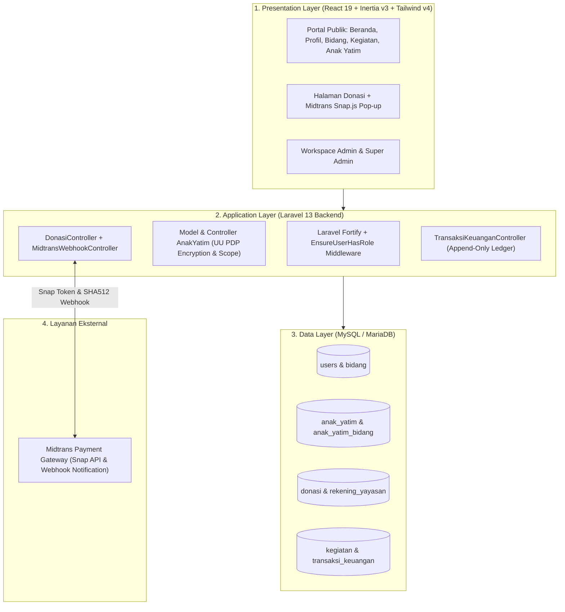

# Modul 04: Arsitektur Sistem, Skema Database, & Rencana Pengujian (UAT)

**PIC Utama:** Rafi Ghazy Athallah (System Analyst & PM), Azka Fadhlan R. & Virgiano Fadhil (Database & Architecture), Muhammad Haikal Akbar (QA/QC).

---

## 1. Arsitektur Sistem Berlapis (3-Tier + Midtrans Gateway)

---

## 2. Daftar Tabel & Model Aktual pada Codebase (`app/Models/`)

Seluruh penamaan tabel di bawah ini sudah disesuaikan 100% dengan model Eloquent yang ada di `app/Models/`:

| Nama Tabel | Model Eloquent | Fitur Kunci & Aturan Bisnis di Codebase |
| :--- | :--- | :--- |
| **`users`** | `App\Models\User` | Menyimpan akun pengurus (`role`: `'admin'` atau `'super_admin'`, `bidang_id`, `phone`, `is_active`). Memiliki helper `isSuperAdmin()`, `isAdmin()`, `hasRole()`. |
| **`bidang`** | `App\Models\Bidang` | Menyimpan 4 bidang utama yayasan (*Pendidikan, Kemanusiaan, Keagamaan, Ekonomi & Koperasi*). |
| **`anak_yatim`** | `App\Models\AnakYatim` | Menyimpan data anak binaan. `nik` dienkripsi (`encrypted` cast), `nik` & `alamat_detail` disembunyikan di `$hidden` (UU PDP). Memiliki relasi *many-to-many* ke `bidang` melalui tabel pivot **`anak_yatim_bidang`**. |
| **`kegiatan`** | `App\Models\Kegiatan` | Menyimpan kegiatan yayasan (`judul`, `bidang_id`, `kategori`, `deskripsi`, `lokasi`, `tanggal_kegiatan`, `gambar`, `created_by`). Memiliki scope `visibleTo($user)`. |
| **`rekening_yayasan`** | `App\Models\RekeningYayasan` | Menyimpan informasi rekening resmi yayasan (BSI & BRI a.n. Yayasan Geliyat Mahdiesa Nahate). |
| **`donasi`** | `App\Models\Donasi` | Menyimpan transaksi donasi (`kode_donasi`, `nama_donatur`, `no_whatsapp`, `jenis_donasi`, `anak_yatim_id`, `nominal`, `pesan_doa`, `status_verifikasi`, `verified_at`) + integrasi `snap_token` Midtrans. |
| **`transaksi_keuangan`** | `App\Models\TransaksiKeuangan` | Buku kas yayasan (*append-only*). Kolom: `kode_transaksi`, `tipe` (`pemasukan`/`pengeluaran`), `sumber_dana` (`donasi`/`operasional`), `kategori`, `nominal`, `tanggal_transaksi`, `donasi_id`, `status_transaksi` (`valid`/`void`), `bukti_nota`. |

---

## 3. Pembagian Tanggung Jawab Tim (Warjett — 8 Anggota)

| No | Nama Anggota | NIM | Role | Fokus Modul yang Dikerjakan |
| :-: | :--- | :---: | :--- | :--- |
| 1 | **Rafi Ghazy Athallah** | 2405433 | Project Manager & System Analyst | Koordinasi WBS/Gantt Chart, penyusunan PRD/SRS, arsitektur sistem, serta integrasi autentikasi & dashboard role. |
| 2 | **Azka Fadhlan Ramadhan** | 2407307 | Back-end Developer | Pengembangan bisnis logika backend, model database, serta integrasi API & Webhook **Midtrans**. |
| 3 | **Virgiano Fadhil** | 2409439 | Full-stack Developer | Integrasi autentikasi multi-role, CI/CD GitHub Actions, buku kas keuangan, dan deployment server. |
| 4 | **Fadhil Anwar Ahsani** | 2407136 | Front-end Developer | Implementasi antarmuka *Company Profile*, katalog kegiatan, dan antarmuka pembayaran donasi Midtrans Snap. |
| 5 | **Nabil Rizky Ramadhan S.** | 2403272 | Front-end Developer | Implementasi antarmuka direktori & CRUD pendataan anak yatim serta dashboard operasional admin. |
| 6 | **Hanifi Raditya Nasution** | 2405518 | UI/UX Designer | Perancangan desain autentikasi berbasis role, dashboard, dan manajemen data anak yatim di Figma. |
| 7 | **Naufal Zahran F.** | 2409107 | UI/UX Designer | Perancangan moodboard, *design system*, halaman *Company Profile*, dan alur donasi digital di Figma. |
| 8 | **Muhammad Haikal Akbar** | 2409474 | QA / QC Engineer | Penyusunan *test case*, pengujian otomatis (Pest PHP), pengujian keamanan RBAC/Midtrans, serta koordinasi UAT & kuesioner SUS bersama pihak yayasan. |

---

## 4. Matriks Skenario Uji User Acceptance Testing (UAT)

| Kode Uji | Modul yang Diuji | Skenario Pengujian | Cara Ukur | Indikator Lulus ($H_1$) |
| :--- | :--- | :--- | :--- | :--- |
| **UAT-01** | Company Profile & Kegiatan | Pengurus dan masyarakat menjelajahi halaman profil, 4 bidang, serta mempublikasikan kegiatan baru. | Kuesioner **SUS** (minimal 10 responden pengurus & donatur) + *checklist* konten. | Rata-rata skor **SUS > 68** & kelengkapan konten **100%**. |
| **UAT-02** | Pendataan Anak Yatim & UU PDP | Admin kelurahan menginput/memperbarui data anak yatim & mengecek proteksi atribut `nik` di halaman publik. | Pencatatan waktu pengisian/pembaruan data sebelum vs sesudah sistem + inspeksi JSON publik. | Waktu pembaruan **turun >= 50%** & data sensitif aman 100%. |
| **UAT-03** | Donasi Midtrans & Kas Otomatis | Donatur melakukan pembayaran via Midtrans Snap Simulator (QRIS / Virtual Account), lalu sistem menerima webhook `settlement`. | Uji transaksi *end-to-end* di Midtrans Sandbox & audit tabel `transaksi_keuangan`. | Status donasi otomatis **`terverifikasi`** & saldo kas bertambah **100% akurat** tanpa rekap manual. |
| **UAT-04** | Pembatasan Role (Admin vs Super Admin) | Akun `admin` bidang mencoba mengakses menu Keuangan (`/admin/keuangan`) dan Manajemen Pengguna (`/admin/pengguna`). | Pengujian hak akses rute dan scope `visibleTo`. | Sistem menolak akses (**403 Forbidden**) untuk rute eksklusif Super Admin. |

