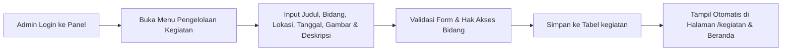

# Modul 01: Company Profile & Pengelolaan Kegiatan Yayasan

**Terkait Rumusan Masalah:** RM-01 (Informasi dan publikasi kegiatan yayasan belum terpusat)  
**Target Keberhasilan:** Kelengkapan konten 100%, minimal 4 publikasi kegiatan/bulan, dan Skor SUS > 68.  
**Model Terkait:** `App\Models\Bidang`, `App\Models\Kegiatan`  
**PIC Utama:** Fadhil Anwar Ahsani (Frontend), Naufal Zahran F. (UI/UX), Azka Fadhlan R. (Backend).

---

## 1. Tujuan Modul
Menyediakan kanal informasi digital resmi milik Yayasan Geliyat untuk memperkenalkan identitas yayasan, sejarah, struktur organisasi, 4 bidang program kerja, serta mempublikasikan dokumentasi kegiatan secara terstruktur tanpa bergantung lagi pada halaman Facebook pihak ketiga (BKMM Ujungberung).

---

## 2. Kebutuhan Fungsional (Functional Requirements)

### A. Sisi Publik (Pengunjung / Masyarakat Umum)

| ID | Nama Fitur | Deskripsi & Aturan Bisnis | Prioritas |
| :--- | :--- | :--- | :--- |
| **FR-CP-01** | **Beranda (Homepage `/`)** | Menampilkan *hero section* ajakan peduli yatim, statistik ringkas yayasan (jumlah anak binaan aktif, 5 kelurahan, 4 bidang), kartu 4 bidang utama, sorotan kegiatan terbaru, serta tombol CTA menuju halaman Donasi. | Wajib (High) |
| **FR-CP-02** | **Halaman Profil Yayasan (`/profil`)** | Menampilkan sejarah berdirinya Yayasan Geliyat (sejak 2023 di Ujungberung), Visi & Misi, legalitas/hak paten, cakupan 5 kelurahan binaan, serta Struktur Organisasi (*Dewan Pembina & Pengurus Harian*). | Wajib (High) |
| **FR-CP-03** | **Halaman Empat Bidang (`/bidang`)** | Menampilkan rincian program kerja pada 4 bidang utama (`tabel bidang`): 1. **Pendidikan:** *Bimbel Sinar (SD), Gemilang, Gemar (SMP/SMA), Beasiswa Peringkat 1, Geliyat Mensarjanakan*. 2. **Kemanusiaan:** *Pendataan Anak Yatim, Santunan Bulanan/Munggahan/Lebaran, UBAY (Ulin Bareng Anak Yatim)*. 3. **Keagamaan:** *Binatulya (Bina Orang Tua Yatim), Turun Wilayah (Turwil), Tahsin Pengurus*. 4. **Ekonomi & Koperasi:** *Penjualan sembako, simpanan pokok/wajib/sukarela, simpan pinjam anggota*. | Wajib (High) |
| **FR-CP-04** | **Katalog & Pencarian Kegiatan (`/kegiatan`)** | Menampilkan daftar berita dan dokumentasi kegiatan yayasan dari tabel `kegiatan`. Dilengkapi fitur **Live Search** (pencarian `judul`/`deskripsi`) dan **Filter Kategori Bidang** (*Semua, Pendidikan, Kemanusiaan, Keagamaan, Ekonomi*). | Wajib (High) |
| **FR-CP-05** | **Detail Kegiatan** | Menampilkan informasi lengkap kegiatan: `gambar`, `tanggal_kegiatan`, `lokasi`, `kategori` / `bidang`, dan `deskripsi` lengkap. | Menengah (Medium) |

---

### B. Sisi Internal Admin Panel (`/admin/kegiatan`)

| ID | Nama Fitur | Deskripsi & Aturan Bisnis | Aktor |
| :--- | :--- | :--- | :--- |
| **FR-KG-01** | **Daftar Kegiatan Berbasis Scope Bidang** | Menampilkan tabel kegiatan menggunakan scope `Kegiatan::visibleTo($user)`:\n- **Super Admin:** melihat seluruh kegiatan.\n- **Admin Bidang:** melihat kegiatan sesuai `bidang_id` miliknya serta kegiatan lintas bidang (`bidang_id = NULL`). | Admin, Super Admin |
| **FR-KG-02** | **Tambah Kegiatan Baru** | Form input kegiatan meliputi: `judul`, `bidang_id`, `kategori`, `tanggal_kegiatan`, `lokasi`, unggah `gambar` (JPG/PNG/WebP maks. 2MB), dan `deskripsi`. Otomatis mencatat `created_by`. | Admin, Super Admin |
| **FR-KG-03** | **Ubah & Perbarui Kegiatan** | Admin dapat menyunting konten kegiatan sesuai hak akses bidangnya. | Admin, Super Admin |
| **FR-KG-04** | **Hapus Kegiatan** | Admin dapat menghapus data kegiatan dengan dialog konfirmasi keamanan. | Admin, Super Admin |

---

## 3. Alur Proses Bisnis (BPMN TO-BE)

---

## 4. Kriteria Penerimaan (Acceptance Criteria — QA)
1. Seluruh halaman publik (`/`, `/profil`, `/bidang`, `/kegiatan`) tampil rapi dan responsif baik di layar smartphone (lebar 360px–430px) maupun desktop (1440px).
2. Filter kategori bidang dan pencarian kata kunci di halaman `/kegiatan` berfungsi secara *real-time* tanpa error.
3. Admin dengan `bidang_id` tertentu hanya dapat memodifikasi kegiatan pada bidangnya sendiri, sedangkan Super Admin dapat mengelola kegiatan seluruh bidang.

