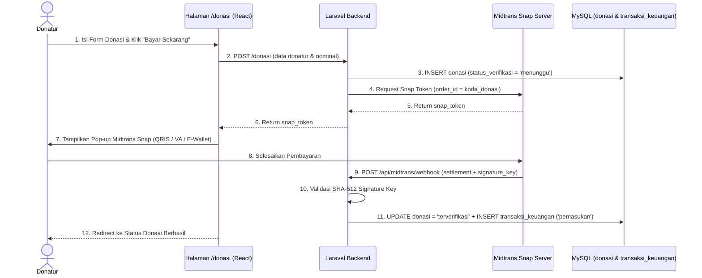

# Modul 03: Donasi Digital (Integrasi Midtrans) & Pembukuan Keuangan

**Terkait Rumusan Masalah:** RM-03 (Mempermudah penyaluran donasi secara digital serta mengotomatisasi pencatatan dan rekapitulasi laporan keuangan yayasan)  
**Target Keberhasilan:** Waktu rekap donasi bulanan bendahara **turun >= 50%** (otomatis *real-time*), rekonsiliasi **100% akurat**, dan peningkatan donasi >= 10%.  
**Model Terkait:** `App\Models\Donasi` (`tabel donasi`), `App\Models\TransaksiKeuangan` (`tabel transaksi_keuangan`)  
**PIC Utama:** Fadhil Anwar Ahsani (Frontend), Azka Fadhlan R. & Virgiano Fadhil (Backend Midtrans & Keuangan), Naufal Zahran F. (UI/UX).

---

## 1. Arsitektur Pembayaran Baru (Midtrans Payment Gateway)

> **Transformasi Alur Donasi:**
> Proses pembayaran donasi diintegrasikan langsung ke **Midtrans Payment Gateway (Midtrans Snap & HTTP Webhook Notification)** tanpa memerlukan pengiriman bukti transfer manual ke WhatsApp.
> Ketika donatur menyelesaikan pembayaran melalui Midtrans, webhook Midtrans otomatis memverifikasi pembayaran dan memicu pencatatan jurnal pemasukan di tabel `transaksi_keuangan`.

---

## 2. Kebutuhan Fungsional (Functional Requirements)

### A. Sisi Donatur / Publik (`/donasi`)

| ID | Nama Fitur | Deskripsi & Aturan Bisnis | Prioritas |
| :--- | :--- | :--- | :--- |
| **FR-DN-01** | **Pilihan Kategori Program Donasi** | Mendukung 5 kategori resmi sesuai konstanta `Donasi::JENIS_DONASI_LIST`: 1. `Donasi Umum` 2. `Santunan Rutin` 3. `Orang Tua Asuh` (dapat memilih `anak_yatim_id` tertentu, min. Rp10.000) 4. `Bimbel Sinar` 5. `Zakat` | Wajib (High) |
| **FR-DN-02** | **Form Donasi & Nominal Cepat** | Input: `nama_donatur` (bisa memilih *Hamba Allah*), `no_whatsapp` / email (untuk bukti pembayaran), `jenis_donasi`, pilihan nominal cepat (*Rp10.000, Rp25.000, Rp50.000, Rp100.000, Rp250.000, atau nominal kustom*), serta `pesan_doa`. | Wajib (High) |
| **FR-DN-03** | **Checkout dengan Midtrans Snap** | Saat donatur menekan tombol **"Bayar Donasi Sekarang"**: 1. Backend men-generate `kode_donasi` unik dan menyimpan transaksi berstatus `menunggu`. 2. Backend memanggil API Midtrans Snap untuk mendapatkan `snap_token`. 3. Frontend membuka pop-up `window.snap.pay(snapToken)` dengan metode pembayaran **QRIS, Virtual Account (BSI, BRI, BCA, BNI, Mandiri), dan E-Wallet (GoPay, ShopeePay, DANA)**. | Wajib (High) |

---

### B. Webhook Otomatis Midtrans & Sinkronisasi Buku Kas (`Backend`)

| ID | Nama Fitur | Deskripsi & Aturan Bisnis | Aktor |
| :--- | :--- | :--- | :--- |
| **FR-DN-04** | **Midtrans Notification Webhook (`/api/midtrans/webhook`)** | Menerima HTTP POST callback dari server Midtrans: 1. Memverifikasi `signature_key` (`hash('sha512', $orderId . $statusCode . $grossAmount . $serverKey)`). 2. Jika `transaction_status` adalah `settlement` atau `capture`:    - Ubah `status_verifikasi` pada `donasi` menjadi `terverifikasi` dan isi `verified_at`.    - Jika `jenis_donasi === 'Orang Tua Asuh'` dan terkait `anak_yatim_id`, pastikan `status_asuh` anak yatim menjadi `aktif_diasuh`. 3. Jika `expire`, `cancel`, atau `deny`: ubah `status_verifikasi` menjadi `dibatalkan` / `ditolak`. | Sistem Otomatis |
| **FR-DN-05** | **Auto-Jurnal ke Buku Kas (`TransaksiKeuangan`)** | Dalam satu `DB::transaction()` saat donasi menjadi `terverifikasi`, sistem otomatis membuat record di tabel `transaksi_keuangan`: - `tipe`: `'pemasukan'` - `sumber_dana`: `'donasi'` - `kategori`: sesuai `jenis_donasi` - `nominal`: sesuai nominal donasi - `donasi_id`: ID donasi terkait - `status_transaksi`: `'valid'` | Sistem Otomatis |

---

### C. Sisi Admin & Super Admin (`/admin/donasi` & `/admin/keuangan`)

| ID | Nama Fitur | Deskripsi & Aturan Bisnis | Aktor |
| :--- | :--- | :--- | :--- |
| **FR-DN-06** | **Monitoring Transaksi Donasi (`/admin/donasi`)** | Menampilkan daftar transaksi donasi (`menunggu`, `terverifikasi`, `ditolak`, `dibatalkan`), pencarian berdasarkan `kode_donasi` / `nama_donatur`, filter jenis donasi, dan detail transaksi. | Admin, Super Admin |
| **FR-KU-01** | **Buku Kas Yayasan Append-Only (`/admin/keuangan`)** | **Khusus Super Admin (`role:super_admin`):** - Menampilkan metrik Total Pemasukan, Total Pengeluaran, dan Saldo Kas Bersih (menggunakan scope `TransaksiKeuangan::valid()`). - Mencatat pemasukan operasional non-donasi & pengeluaran yayasan beserta unggah `bukti_nota`. - **Aturan Audit (Append-Only):** Transaksi keuangan tidak pernah dihapus (`DELETE`); jika terjadi kesalahan input, transaksi dibatalkan dengan mengubah `status_transaksi` menjadi `'void'`. | **Super Admin Only** |

---

## 3. Diagram Sequence Integrasi Midtrans

---

## 4. Penyesuaian Kolom Tabel `donasi` untuk Midtrans
Untuk mendukung Midtrans secara penuh, tabel `donasi` mencakup atribut pembayaran gateway:
- `kode_donasi` (digunakan sebagai `order_id` di Midtrans)
- `snap_token` (`string`, nullable — menyimpan token Snap untuk membuka kembali pop-up jika belum dibayar)
- `payment_type` / `rekening_tujuan` (`qris`, `bank_transfer`, `gopay`, `echannel`, dll.)
- `midtrans_transaction_id` (`string`, nullable — ID referensi dari Midtrans)

